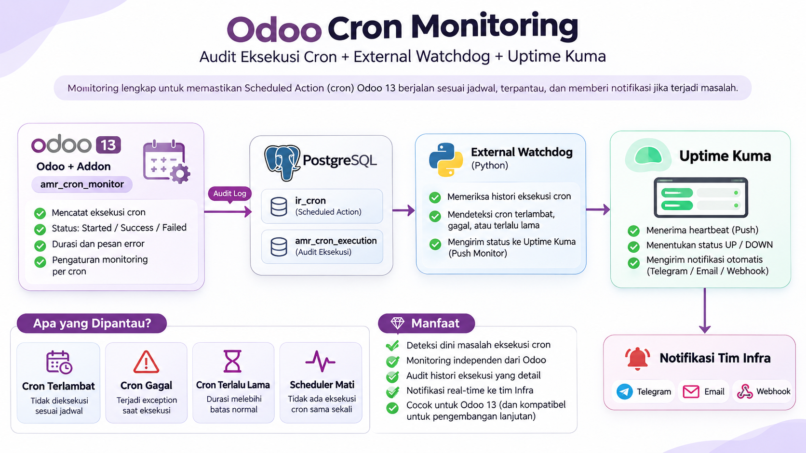

# Cron Execution Audit (`amr_cron_monitor`)

An Odoo 13 module that instruments `ir.cron` execution to provide detailed audit trails and enable external monitoring for scheduled actions. 

This addon is the internal Odoo component of the **Odoo Cron Audit + Uptime Kuma Watchdog** architecture. It records execution states ('started', 'returned', 'raised') in a dedicated audit table and adds configuration parameters for external health checks.

## Architecture



## Features

- **Execution Audit Trail**: Logs the start time, finish time, and final state of every monitored cron job into a new model (`amr_cron_execution`).
- **Autonomous Transactions**: Uses a separate database cursor for audit logging. This ensures that a cron job's `started` and `raised` states are permanently recorded even if the main business transaction fails and rolls back.
- **Per-Cron Configuration**: Adds monitoring toggles directly to the Scheduled Actions form view (`ir.cron`):
  - `amr_monitor_enabled`: Opt-in boolean to enable auditing and watchdog tracking for a specific job.
  - `amr_grace_minutes`: The acceptable delay (in minutes) after `nextcall` before the job is considered overdue.
  - `amr_max_runtime_minutes`: The maximum allowed execution time before a running job is considered stuck/zombie.

## Installation (Odoo Addon)

1. Clone or download this repository.
2. Place the `amr_cron_monitor` directory into your Odoo 13 `addons` path.
3. Restart your Odoo server.
4. Activate Developer Mode in Odoo.
5. Navigate to **Apps**, click **Update Apps List**.
6. Search for **Cron Execution Audit** and click **Install**.

## Configuration & Usage

1. Go to **Settings > Technical > Automation > Scheduled Actions**.
2. Open the cron job you want to monitor.
3. In the new **Monitoring** tab:
   - Check **Monitor Cron** (`amr_monitor_enabled`).
   - Set the **Grace Period (minutes)** (e.g., `10` minutes). This accommodates normal job scheduling queues and server load.
   - Set the **Max Runtime (minutes)** (e.g., `30` minutes). This defines when an ongoing job should trigger an alert.
4. Save the changes. The external watchdog script will now actively track this job.

To view the execution history:
- Go to **Settings > Technical > Automation > Cron Executions** (if a menu item was created), or query the `amr_cron_execution` table directly in PostgreSQL.

## External Watchdog Installation

While this module provides internal Odoo auditing, it is designed to be paired with the **External Odoo Cron Watchdog**. The watchdog is a lightweight Docker container that reads this addon's audit logs and pushes real-time health metrics/alerts to Uptime Kuma.

You can automatically deploy the external watchdog on your server by running the following one-liner installation script:

```bash
curl -sSL https://raw.githubusercontent.com/agusramdan/odoo_13_addons/main/cron-whatcdog/install.sh | bash
