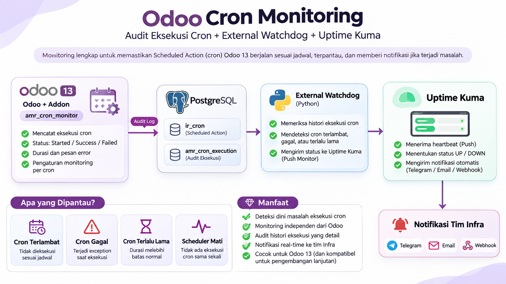

# Odoo 13 Cron Audit + Uptime Kuma Watchdog

## Architecture

## Components
- `../amr_cron_monitor`: optional per-cron monitoring settings and callback audit.
- `watchdog`: independent read-only PostgreSQL checker and Uptime Kuma push client.
- `docker-compose.yml`: watchdog container only; reuse your existing Odoo/PostgreSQL/Kuma deployment.

## Deployment
1. Back up Odoo database; test on staging first.
2. Copy addon to Odoo addons path, update Apps list, install **Cron Execution Audit**.
3. In Settings > Technical > Automation > Scheduled Actions, enable **Monitor Cron** on selected important jobs and set grace/runtime limits. Confirm the view inheritance matches your Odoo 13 fork.
4. Create a read-only PostgreSQL role using `sql/create_monitor_user.sql`, replacing credentials and database name.
5. In Uptime Kuma create **two Push monitors**: `Odoo Cron Health` and `Odoo Watchdog Health`. Copy their unique URLs into `.env` (copy `.env.example` first). Keep `.env` private.
6. Attach watchdog to a network that can resolve PostgreSQL and Uptime Kuma. Run `docker compose up -d --build`.
7. Configure Telegram/email notification and test DOWN/UP recovery. Test Odoo worker termination in staging.

## Important accuracy limitations
- The Odoo 13 `_callback` override records **returned**, not guaranteed success: some Odoo versions catch/log business exceptions *inside* the parent callback. A returned callback may have failed internally. For authoritative success/failure, instrument the business method itself or patch the exact Odoo version's exception-handling boundary.
- Audit STARTED and final records use a separate DB transaction, so they survive the business transaction rollback. But a hard process kill can leave STARTED permanently; watchdog interprets it as unclosed/stuck.
- A returned audit row may precede final business transaction commit; it does **not** prove business effects committed.
- The watchdog only monitors explicitly opted-in active cron jobs. It cannot discover a disabled job that is no longer active; add a separate policy check for required cron IDs if that is needed.
- `nextcall` overdue is a heuristic. Locks, scheduling delays, and long-running jobs can cause false positives; tune grace/runtime for each job.
- An active cron with `nextcall` advancing but no completed audit can evade this minimal monitor. For strict execution guarantees, add per-job expected cadence and last-committed-success instrumentation.
- This starter monitors one database. Run one container per database or extend config for multi-database.
- Odoo 13 forks may use a different `_callback` signature or XML view external ID. Verify before deployment.
- Keep audit tables bounded: set a retention policy (e.g. external SQL maintenance with a backup and index-aware batching), rather than relying on the Odoo cron itself for cleanup.

## Testing
- Stop watchdog container: Watchdog Push monitor must become DOWN after its heartbeat timeout.
- Block DB connection: Cron Health DOWN; Watchdog Health eventually DOWN.
- Make a selected cron overdue in staging: Cron Health DOWN.
- Trigger a callback exception in staging: verify whether the parent swallows it; never treat `returned` as confirmed business success.
- Restore normal conditions and verify recovery notifications.

## Security
Use least-privilege SELECT grants; never expose PostgreSQL publicly; use private Docker networks/TLS; store secrets outside source control. Uptime Kuma Push URLs are bearer secrets.
